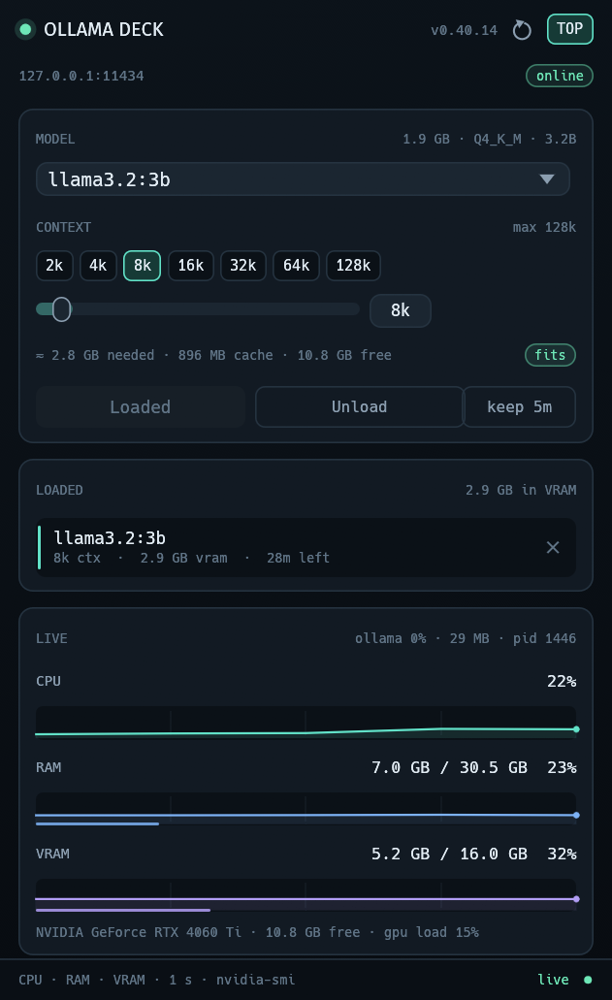

# Ollama Deck

A small desktop widget for Linux that shows what your Ollama models are doing and lets you
load, unload and tune them from one compact window.



It sits in a corner of the screen (always on top by default), polls your local Ollama server
once a second, and draws live CPU, RAM and VRAM graphs next to your model list. The memory
numbers come from your own hardware — there is no built-in VRAM size to configure.

## What it does

- **Pick a model** from everything `ollama list` would show, with its size, quantisation and parameter count.
- **Pick the context size** with one-click chips (2k … 128k) or a fine slider, and see the VRAM the choice will need before you commit to it.
- **Load** a model into memory at that context size, or **Unload** it (or any other resident model) to free memory immediately.
- **Keep-alive** control: 5 minutes, 15 minutes, 1 hour or forever — how long Ollama keeps the model resident after you stop using it.
- **Live monitor**: system CPU, RAM and GPU memory usage with a one-minute sparkline, plus GPU load and the RSS/CPU of the `ollama` process itself.
- **Stays on top** so it can live beside your editor. The TOP button toggles that.

## Memory numbers come from your machine

There is no hard-coded VRAM limit. Every second the widget asks the driver for the card's real
total and used memory:

- NVIDIA: `nvidia-smi --query-gpu=name,memory.total,memory.used,utilization.gpu`
- AMD, and drivers that expose DRM sysfs: `mem_info_vram_total` / `mem_info_vram_used`

The VRAM meter and the “free” figure therefore follow whatever card is installed — 8 GB, 16 GB,
24 GB or more. If several GPUs are present, the one with the most memory is used (the usual case
for a laptop with a small integrated GPU). When a model is reloaded, the widget compares the
estimate with the memory that is actually free at that moment, plus whatever the selected model
already holds. The “fits” pill is advice, not a cap: Ollama can still choose to put some layers
in system RAM.

## Requirements

- Linux with a graphical session (X11 or Wayland)
- [Ollama](https://ollama.com) running locally (`ollama serve`, the desktop app, or systemd)
- For the VRAM graph: the NVIDIA driver (`nvidia-smi`), or an AMD card exposing `mem_info_vram_used` in sysfs
- Rust 1.80+ **only if you build from source** — the installer above ships a ready-made binary

Without a GPU the widget still works — it simply says "no GPU" instead of drawing VRAM.

## Install

One line, nothing else to install:

```bash
curl -fsSL https://raw.githubusercontent.com/mjb73/ollama-deck/main/get.sh | sh
```

It downloads the latest Linux build from the [releases page](https://github.com/mjb73/ollama-deck/releases),
puts `ollama-deck` in `~/.local/bin` and adds an **Ollama Deck** entry to your application menu.

### From source

```bash
git clone https://github.com/mjb73/ollama-deck.git
cd ollama-deck
./install.sh
```

The script builds a release binary (a few minutes the first time), installs it to
`~/.local/bin/ollama-deck` and adds the menu entry. If you prefer to do it by hand:

```bash
cargo install --path . --locked
```

## Use

Launch **Ollama Deck** from the menu, or run `ollama-deck`.

1. Pick a model. If something is already loaded, the widget selects it for you.
2. Pick a context size. The line under the chips shows roughly how much VRAM the weights plus
   the key/value cache will take, how much is free on the card right now, and whether that still
   fits next to whatever is already resident.
3. Press **Load**. The resident list appears above the graphs with its size, context and how
   long it has left before Ollama evicts it.
4. Press the small × on a resident model to unload it, or **Unload** for the selected one.

The window is resizable and remembers nothing between runs — it simply reflects the server.

### When a model does not load the way you expected

Ollama answers "done" even when the result is not the one you asked for, so the widget reads
back the resident model from the server and tells you what really happened:

- **VRAM climbs and then disappears.** The keep-alive request was being read as a number of
  *seconds* rather than minutes, so the model was evicted a moment after loading. Durations are
  now sent as `5m` / `15m` / `60m`, and the resident row counts down the time it has left.
- **The context size stays what it was.** Ollama reuses the running model, so changing `num_ctx`
  while the model is loaded has no effect. When the size you picked differs from the resident
  one the button becomes **Reload**, which unloads first and then loads at the new size.
- **The model is bigger than the card.** Ollama moves the layers that do not fit to system RAM.
  The widget says so (`1.2 GB in RAM`) and the resident row splits VRAM from RAM instead of
  pretending the whole model is on the GPU.
- **VRAM fills up on a small model.** The key/value cache grows with the context, not the model
  size. A 3B model at 128k can hold far more cache than its weights; try 8k or 16k, which the
  estimate line shows before you press Load.
- **The size is larger than the model supports.** Ollama silently caps it at the model's own
  limit. The chips are limited to that maximum, and if the server still caps a request the
  widget says `capped from 64k`.
- **"not enough memory for that context".** The server's error is translated into that sentence
  instead of a raw HTTP 500.

## How it works

Everything goes through Ollama's own HTTP API on `127.0.0.1:11434` (override with `OLLAMA_HOST`):

| Action | Endpoint |
| --- | --- |
| model list | `GET /api/tags` |
| resident models | `GET /api/ps` |
| model shape (context limit, KV heads) | `POST /api/show` |
| load at a context size | `POST /api/generate` with `options.num_ctx` and `keep_alive` |
| unload | `POST /api/generate` with `keep_alive: 0` |

System numbers come from `/proc/stat`, `/proc/meminfo`, `nvidia-smi` (or AMD sysfs) and the
`ollama` process's own `/proc/<pid>/stat`. No Python, no daemon, no background service: one
process, one window.

The VRAM estimate is weights + `num_ctx × kv_heads × (key_len + value_len) × 2 bytes`, read from
the model metadata. It is an estimate — Ollama's own allocation rounding varies a little — but
it is close enough to choose a context size with.

## Development

```bash
cargo run
cargo run -- --screenshot shot.png   # draw the window, save a PNG, exit
```

## Fonts

Bundled: Fira Sans and Hack, both under the SIL Open Font License (see `assets/FIRA-OFL.txt`).

## License

MIT — see `LICENSE`.
